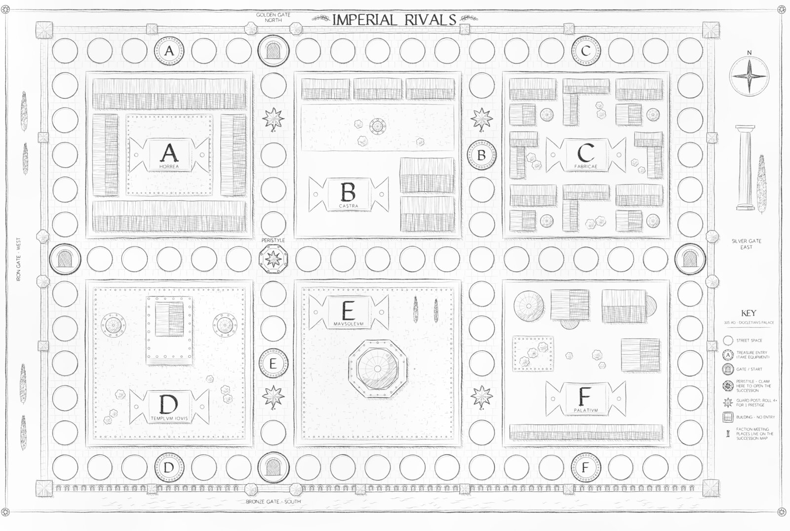
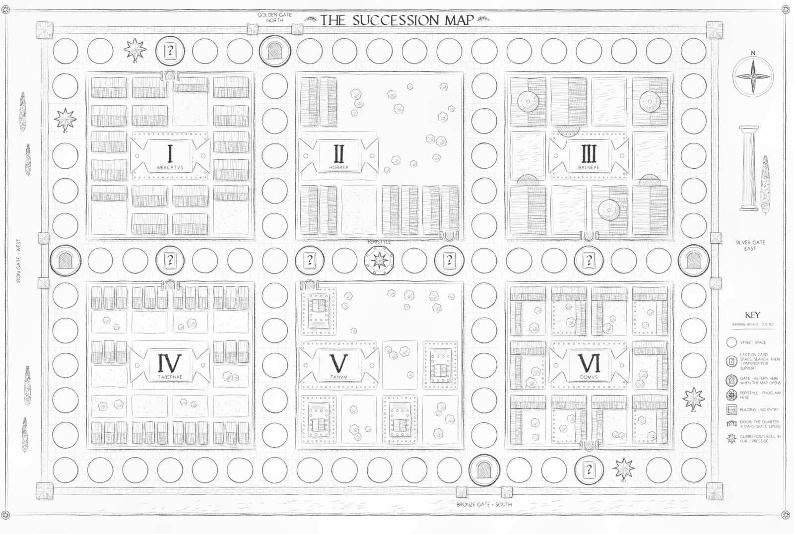
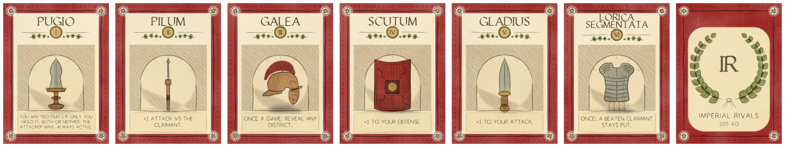
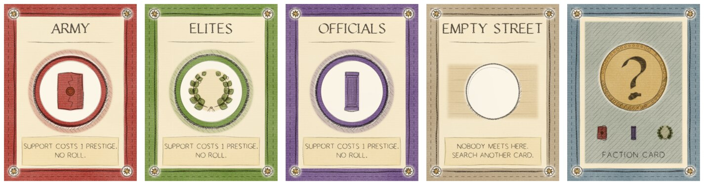

# Imperial Rivals: 305 AD

*The Roman Succession. Claim the throne. Survive the challenge.*



Imperial Rivals is a competitive board game for four players. It is set in
Diocletian's Palace, Split, in 305 AD. The emperor steps down, and you race
your rivals to take his place. Imperial Rivals is the series name; 305 AD is
the first edition.

**[Play in your browser](https://dioclet-board.nikola-balic.workers.dev)** ·
**[Print the kit](print/imperial-rivals-305ad-complete-print-kit-A4-ART.pdf)** ·
**[Run the simulator](#run-the-simulator)**

## How a game plays

1. **Arm yourself in the palace.** Start at one of four gates. Roll two dice
   to move, open the six treasure blocks, and collect equipment. Fight rivals
   in duels and roll at guard posts to earn Prestige.
2. **Turn the board over.** The first player with all six items claims the
   checkpoint at the Peristyle. One more full round later, the board turns
   over to the succession map, and every player returns to a gate. Each
   gate is nine steps from the Peristyle.
3. **Find the factions.** Six face-down cards sit beside the six blocks.
   Three hide the Army, the Elites, and the Officials. Three are empty
   streets. Pay 1 Prestige to win the support of a faction you find.
4. **Claim the throne.** With two factions behind you, claim the Peristyle.
   Rivals can cancel your claim only by beating you in a duel. Hold it for
   two full rounds to win.



### The cards

Six pieces of equipment change how duels and claims play out. At most one
equipment modifier applies to each side of a duel.



The faction cards hide among blanks until a player searches them.



All artwork is drawn by code: seeded pen, graphite, and charcoal strokes on
a paper texture, with hand-lettered Roman capitals. The colour edition adds
watercolour glazes. See [`art/`](art/).

## What this repository holds

- A deterministic Python simulator with bots, model players, and
  experiment tools.
- A browser game that runs the same rules, checked move for move against
  the simulator.
- A print-and-play kit in a drawn edition, a full-colour edition, and a
  black-and-white edition.
- The experiments, findings, and decisions behind every rule change.

## Current versions

The simulator, print kit, and browser game share one rules file:

| Component | Rules | Status |
| --- | --- | --- |
| Python simulator | [V0.10.2 rules file](rules/imperial-rivals-v0.10.2.json) | Current design candidate |
| [Print kit](print/) | V0.10.2 big board | Generated PDFs; needs human playtesting |
| [Browser game](web/) | V0.10.2 big board | Playable with humans and bots; Python parity |

**V0.10 uses two boards of the same size.** Players collect equipment on
the palace board, then turn the board over and return to their gates on the
succession map. It has the same six blocks and streets. Every gate there is
nine steps from the Peristyle, and four guard posts let players earn Prestige
there too. The three factions hide among six face-down cards, one beside each
block, with three blanks. Players search the
cards, buy support from two factions, and defend a claim at the Peristyle for
two rounds. Six equipment abilities affect play; at most one equipment
modifier applies per duel side.

The browser engine is a port of the Python engine. The parity check
replays seeded games against `engine.py` and matches every legal
action, die, and state. See the
[V0.10 findings](docs/findings/FINDINGS_V10.md) and the
[V0.10 notes](notes/v10-level2-2026-11-14.md) for the evidence and open
questions.

## Play in the browser

The browser game uses plain HTML, CSS, and JavaScript. No build step is required.
From the repository root, start a local server:

```bash
python3 -m http.server 8000 --directory web
```

Open <http://localhost:8000>. Choose human or bot players and use
**How to play** for the full rulebook.

The board data and rulebook are generated from
`rules/imperial-rivals-v0.10.2.json`:

```bash
python3 tools/make_web_board.py
```

This command regenerates `web/board-data.js` and `web/rules.js`. It fails
when the rules file is not the twin-board succession variant. Cloudflare
hosting is configured in [`wrangler.jsonc`](wrangler.jsonc).

## Print and play

The default edition is the [drawn kit](print/imperial-rivals-305ad-complete-print-kit-A4-ART.pdf).
It carries hand-drawn grayscale artwork (boards, cards, and tokens drawn
programmatically, see `art/`):

- [Palace board, drawn art: four A4 tiles](print/imperial-rivals-305ad-board-4xA4-ART.pdf)
- [Succession map, drawn art: four A4 tiles](print/imperial-rivals-305ad-succession-map-ART.pdf)
- [Cards and tokens, drawn art](print/imperial-rivals-305ad-cards-tokens-ART.pdf)

For a colour printer, use the [full-colour kit](print/color/imperial-rivals-305ad-complete-print-kit-A4-COLOR.pdf).
It is the same drawing with watercolour glazes: terracotta roofs, gold
treasure entries, gates in the colour of their metal, and faction cards in
red (army), purple (officials), and green (elites):

- [Palace board, full colour: four A4 tiles](print/color/imperial-rivals-305ad-board-4xA4-COLOR.pdf)
- [Succession map, full colour: four A4 tiles](print/color/imperial-rivals-305ad-succession-map-COLOR.pdf)
- [Cards and tokens, full colour](print/color/imperial-rivals-305ad-cards-tokens-COLOR.pdf)

All three complete kits start with the rulebook, quick reference, teaching guide,
and player sheets. The print instructions come next, right before the pages to
cut: the palace board, the succession map, then the cards and tokens.

The [black-and-white kit](print/bw/imperial-rivals-305ad-complete-print-kit-A4-BW.pdf)
uses black ink only and is the source of the rules documents:

- [Palace board: four A4 tiles](print/bw/imperial-rivals-305ad-board-4xA4-BW.pdf)
- [Succession map: four A4 tiles](print/bw/imperial-rivals-305ad-succession-map-A4-BW.pdf)
- [Player sheets](print/bw/imperial-rivals-305ad-player-sheets-A4-BW.pdf)
- [Cards and tokens](print/bw/imperial-rivals-305ad-cards-tokens-A4-BW.pdf)
- [Rulebook](print/bw/imperial-rivals-305ad-rulebook-A4-BW.pdf)
- [Quick reference](print/bw/imperial-rivals-305ad-quick-reference-A4-BW.pdf)
- [Teaching guide](print/bw/imperial-rivals-305ad-teaching-guide-A4-BW.pdf)
- [Playtest form](print/bw/imperial-rivals-305ad-playtest-form-A4-BW.pdf) (separate file,
  not in the complete kits)
- [Print and assembly instructions](print/bw/imperial-rivals-305ad-print-instructions-A4-BW.pdf)

Each board assembles to 580 × 406 mm from four A4 tiles. The two boards
share their cut lines, so you can tape them back to back. Follow the print
instructions and check the 100 mm calibration ruler.

All kits print the same geometry: the art consumes a layout exported
from the generator itself (`art/build/layout.json`), never a copy.

To regenerate the kit from `rules/imperial-rivals-v0.10.2.json`, install ReportLab:

```bash
python3 -m pip install reportlab
python3 tools/make_a4_print_kit.py          # black-and-white kit
python3 tools/make_a4_print_kit.py --art    # also the drawn kit
python3 tools/make_a4_print_kit.py --art --color  # and the full-colour kit
```

The drawn assets are seeded and reproducible. To re-render them after
changing the rules or the drawing code (`@napi-rs/canvas` needs Node 18+):

```bash
python3 art/export_layout.py
cd art && npm ci && node render.mjs && node render.mjs --color && cd ..
python3 tools/make_a4_print_kit.py --art --color
```

The colour assets land in `art/build/assets-color/`. The colour edition
draws the same lines from the same seeds as the grayscale edition and adds
one pigment layer, so `node render.mjs` without `--color` stays
byte-identical.

The README images in `docs/images/` are reduced copies of the colour assets.
Rebuild them with ImageMagick:

```bash
tools/make_readme_images.sh
```

The generator updates the PDFs and [`print/kit-manifest.json`](print/kit-manifest.json).
Use the [current playtest protocol](playtest/protocol-v09.md) to record a human session.

## Run the simulator

Use Python 3.11 or newer. The engine and built-in bots use only the standard library.
Run commands from the repository root.

### Validate, play, and replay a game

Use a new output directory for each game:

```bash
python3 sim.py validate --rules rules/imperial-rivals-v0.10.2.json
python3 sim.py new --rules rules/imperial-rivals-v0.10.2.json --seed 42 \
  --out runs/demo --policies balanced,greedy,aggressive,random
python3 sim.py auto --run runs/demo
python3 sim.py replay --run runs/demo --verify
```

The four policy names map to players `P0`, `P1`, `P2`, and `P3` in that order.
The run directory stores the game state and event log.

### Submit individual actions

After `new`, inspect the active player's observation before you use `auto`:

```bash
python3 sim.py observe --run runs/demo --player P0
```

Use `first_active_player` from the `new` output to select the player.
The observation includes public state and legal actions with stable action identifiers.
Submit the returned `turn_id` and an `action_id` from that observation:

```bash
python3 sim.py act --run runs/demo --player P0 --turn-id 1 \
  --action-id a0001 --note 'open the nearest district'
```

Replace the example values with those from your observation.
`observe` does not change state. An illegal or stale action returns
`legal_action_error` without changing state.

## Run rule experiments

Run a batch of games with the built-in policy schedule:

```bash
python3 sim.py batch --rules rules/imperial-rivals-v0.10.2.json --games 1000 \
  --seed-base 1000 --schedule experiment --out results/baseline-demo
python3 sim.py report --input results/baseline-demo
```

These batches produce `games.csv`, `summary.json`, `experiment.json`,
and sample game logs. Compare two batch summaries with:

```bash
python3 compare.py results/baseline-demo results/variant-demo
```

To test a change:

1. Copy the rules file and change one conceptual rule.
2. Validate the copy with `sim.py validate`.
3. Run both versions with matching seeds, profiles, and gate schedules.
4. Compare the results and confirm the finding on fresh seeds.
5. Record the evidence and limitations before you recommend the change.

Keep each rules file and result directory separate. Read
[`programme.md`](programme.md) before you run rule experiments.
Simulation results inform human playtests; they do not
establish player enjoyment.

## Optional model players

**Arena** is the main way to make decision models play. It gives each seat
its own provider (OpenAI, TypeSafe Jev, Cloudflare Clef, Perplexity, or
Vercel AI Gateway), streams each turn in the terminal, and keeps a full log
for model training. See [`arena/README.md`](arena/README.md):

```bash
cd arena && uv run arena --match matches/bots.json
```

## Check changes

The full Python suite includes PDF checks that require ReportLab and pypdf:

```bash
python3 -m pip install reportlab pypdf
python3 -m unittest discover -s tests
```

For browser changes, run the Node.js checks:

```bash
node tools/test_web_engine.mjs
node tools/test_succession_engine.mjs
node tools/test_succession_parity.mjs
node tools/test_web_ui.mjs
```

The user interface check requires `jsdom`; it prints `SKIP` when that package
is unavailable. The parity check replays seeded games against the Python
engine on the twin-board rules.

## Project map

| Path | Purpose |
| --- | --- |
| [`sim.py`](sim.py) | Command-line interface for games, batches, and replays |
| [`engine.py`](engine.py) | The game engine |
| [`board.py`](board.py) | Board graph, paths, and site lookups |
| [`policies.py`](policies.py), [`tactical_policy.py`](tactical_policy.py) | Built-in bots and deterministic benchmark |
| [`candidate_actions.py`](candidate_actions.py) | Public observations and the action shortlist for model players |
| [`report.py`](report.py), [`compare.py`](compare.py) | Batch statistics and comparisons |
| [`arena/`](arena/) | Terminal app: decision models from different providers play each other |
| [`tools/`](tools/) | Generators, evaluators, experiment runners, and browser checks |
| [`web/`](web/), [`print/`](print/) | Browser game and printable materials |
| [`tests/`](tests/) | Engine, policy, experiment, and print checks |
| [`results/`](results/), [`runs/`](runs/) | Retained V0.10 experiment evidence and games |
| [`notes/`](notes/), [`docs/`](docs/) | Research, design plans, findings, and implementation notes |

## Design history and evidence

The findings files preserve measurements for their versions. Their recommendations
can be superseded by later experiments.

| Stage | Evidence |
| --- | --- |
| V0.1: original rules | [Specification](SPEC.md), [baseline findings](docs/findings/FINDINGS.md) |
| V0.2–V0.3: combat and duel consequences | [Combat and fairness](docs/findings/FINDINGS_V02.md), [duel experiments](docs/findings/FINDINGS_V03.md) |
| V0.4–V0.5: model play and rule trials | [Model players](docs/findings/FINDINGS_V04.md), [V0.4.1 measurements](docs/findings/FINDINGS_V041.md), [rule trials](docs/findings/FINDINGS_V05.md) |
| V0.6–V0.7: physical board geometry | [Board validation](docs/findings/BOARD_VALIDATION_V061.md), [playability scorecard](docs/findings/PLAYABILITY_SCORECARD_V061.md), [findings](docs/findings/FINDINGS_V061.md), [board comparison](notes/board-comparison.md) |
| V0.8: imperial succession | [Redesign plan](docs/intervention-plan.md), [succession findings](docs/findings/FINDINGS_V08.md) |
| V0.9–V0.9.3: equipment, claim windows, and movement | [Trial findings](docs/findings/FINDINGS_V09.md), [simplification study](notes/v09-simplification-study.md), [geometry sweep](notes/v09-geometry-sweep-2026-11-13.md) |
| V0.9.4: separate succession map | [Twin-board findings](notes/v094-twinboard-2026-11-13.md), [human playtest protocol](playtest/protocol-v09.md) |
| V0.10: big succession map and faction cards | [Findings](docs/findings/FINDINGS_V10.md), [notes](notes/v10-level2-2026-11-14.md), [Haiku table game](runs/haiku-table-v0102/REPORT.md) |

[`DECISIONS.md`](DECISIONS.md) records rule interpretations and design decisions.
The superseded rules variants of every stage remain available in git
history; earlier documents cite them by their original root paths.
See [`runs/README.md`](runs/README.md) for the retained runs.

## License

Copyright (c) 2026 Nikola Balic. All rights reserved.
See [`LICENSE`](LICENSE).
